<b>做给 AI Agent 用的创作技能：写作、设计、分镜、动效、3D、剪辑。每个项目都附样片，好不好看，拿成片说话。</b> 
<b>Creative skills for AI agents: writing, design, storyboards, motion, 3D and editing. Every project ships with samples you can watch.</b>

  

## 🧰 xiaoma-design-master

<b>十六个创作工种，一条命令装进你的 Agent。</b>长文、小红书、海报、封面、信息图、分镜、短剧、剪辑、代码动效、3D 场景、PPT、网页 UI，每个技能都有自己的流程、审美规则和自检。一条命令装进 Claude Code、Codex 或任何能读 skill 的 Agent。 
<b>Sixteen creative crafts, one command away.</b> Articles, posters, covers, infographics, storyboards, short dramas, editing, code-driven motion, 3D scenes, decks and web UI, each with its own pipeline, taste rules and self-checks.

 

## ✍️ xiaoma-durex-copywriter

<b>话只说一半，另一半让读者自己笑出来。</b>把黄金期借势海报那套「双层语义 + 留白」拆成 8 个文案公式和一套视觉系统：表层说热点，里层留给读者自己跳过去。换成 AI 课程、职场、理财，机制照样成立。 
<b>Say half. Let the reader laugh out the other half.</b> A double-meaning copywriting method distilled into 8 formulas and a poster system, from copy to finished artwork.

 

## 🎬 xiaoma-studio

<b>每一帧，都是时间的函数。</b>从 30 条高赞动效视频里逐帧拆出的工作流：先写分镜，再看拼图，最后出片；配乐和音效也由代码合成，15 张经典风格卡、独立评委打分，不过线不交付。 
<b>Every frame is a pure function of time.</b> A workflow distilled from 30 viral motion films: storyboard first, contact sheets before renders, code-synthesised sound, 15 style cards and an independent jury.

 

## 🎙️ 明知AI剪辑 · mingzhi

<b>说一遍就好，口误、背景、封面交给它。</b>开源的口播精剪工作台：语音识别在本机跑，剪掉语气词和重复，换背景，自动分镜加卡片和封面，出一条能直接发的竖屏成片；哪里不满意，说一句就改。 
<b>Talk once. It trims the stumbles and dresses the cut.</b> An open-source talking-head editor: local speech recognition, filler-word cuts, new backgrounds, cards and covers, revised by chat.

 

### 更多作品 · More

| 项目 | 一句话 |
|---|---|
| [xiaoma-video-duplicate](https://github.com/crawfordxx/xiaoma-video-duplicate) | 电商短视频逐帧复刻：换人物和场景，保留脚本、动作、运镜与商品 |
| [everything-mobile](https://github.com/crawfordxx/everything-mobile) | 让 AI Agent 驱动一台真实的安卓手机，JSON 进、JSON 出 |
| [video-forge](https://github.com/crawfordxx/video-forge) | 17 个电影感 Remotion 模板，对 AI 说「做个视频」就能出片 |
| [paper-cut-video-skill](https://github.com/crawfordxx/paper-cut-video-skill) | 剪纸风中文科普视频：按内容配角色、配音和语义字幕 |
| [mp-workflow](https://github.com/crawfordxx/mp-workflow) | 公众号工作流：Markdown 排版成内联 HTML，直连微信 API 建草稿 |
| [miniauto-fetch-car](https://github.com/crawfordxx/miniauto-fetch-car) | 低矮家具下的 AI 寻物小车：离线识别、测距、夹取、原路返回 |
| [clipboard-master](https://github.com/crawfordxx/clipboard-master) | 免费开源的剪贴板历史工具 |

